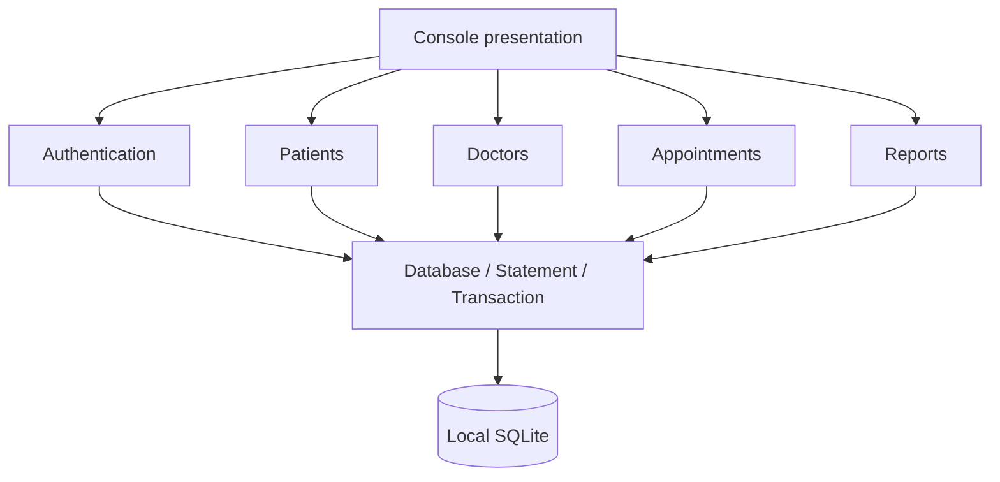
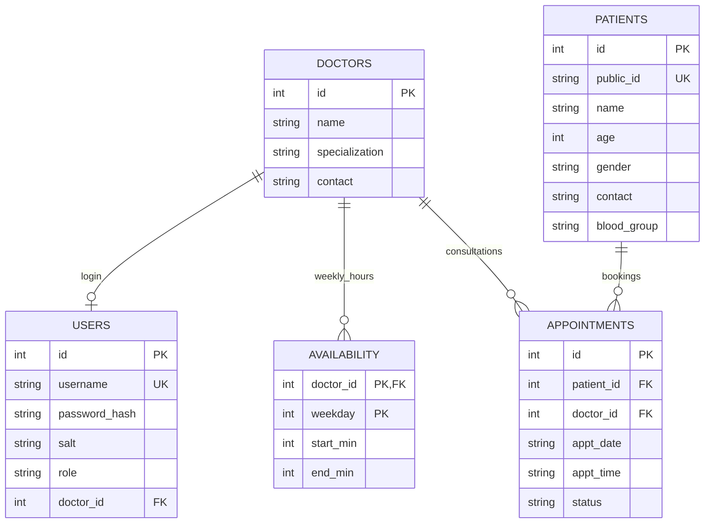
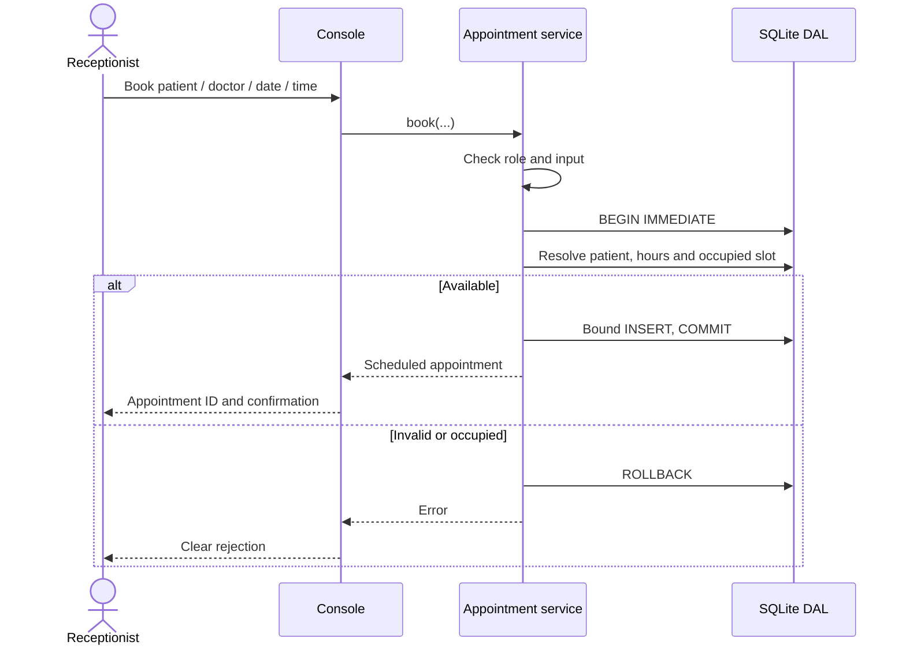

# Implemented architecture

The console calls the HMS business services, which enforce the private session's role and validate inputs before using the SQLite data access layer. Public interfaces and ownership rules are documented with Doxygen-style comments in `include/hms/hms.hpp` and `include/hms/database.hpp`. The complete design specification is `docs/Architecture_Design/HMS_ArchDesign_v1.1.docx`.







```mermaid
sequenceDiagram
    actor R as Receptionist
    participant B as Appointment service
    participant DB as SQLite DAL
    R->>B: Reschedule appointment / date / time
    B->>B: Check role and calendar
    B->>DB: BEGIN IMMEDIATE; read Scheduled record
    B->>DB: Check availability excluding this appointment
    alt Available
        B->>DB: Bound UPDATE; COMMIT
        B-->>R: Rescheduled
    else Conflict or validation failure
        B->>DB: ROLLBACK
        B-->>R: Rejected; original booking preserved
    end
```
